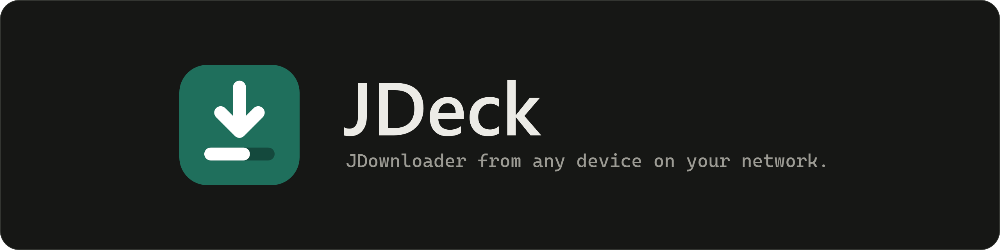
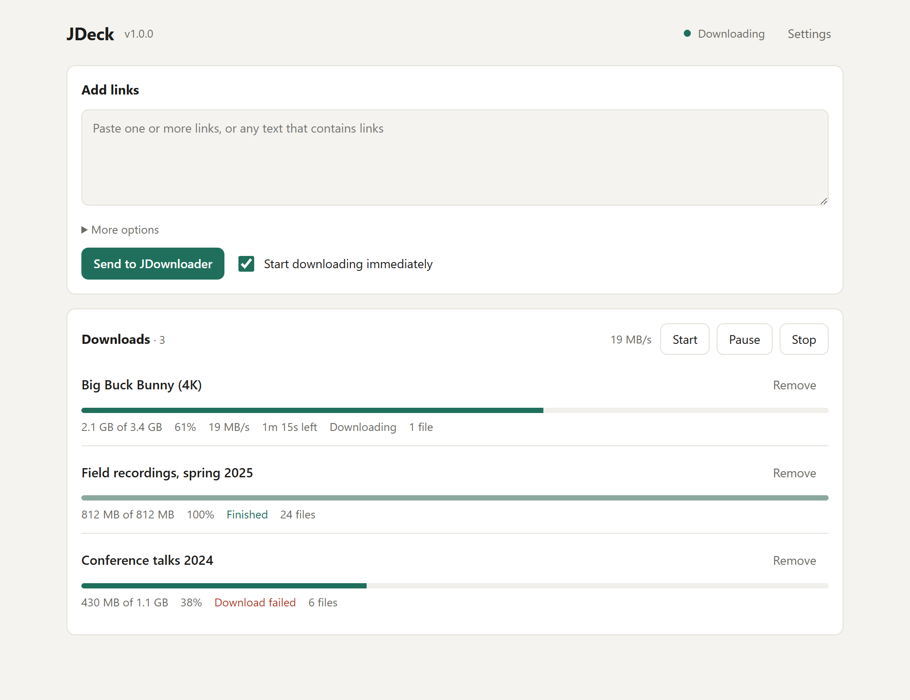
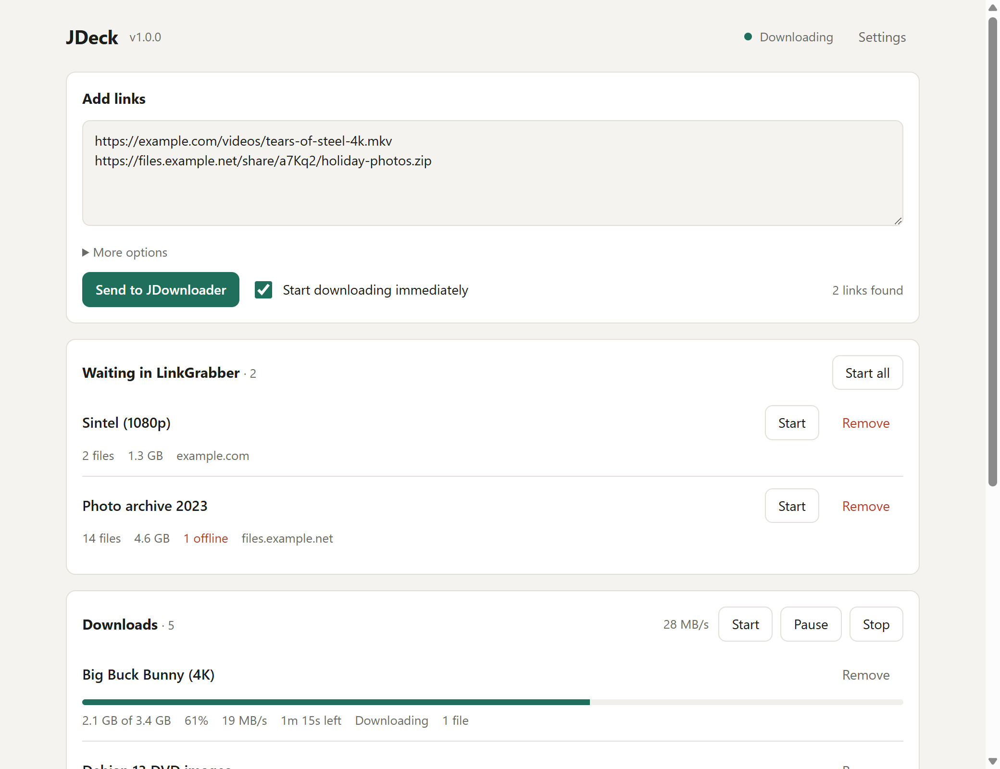
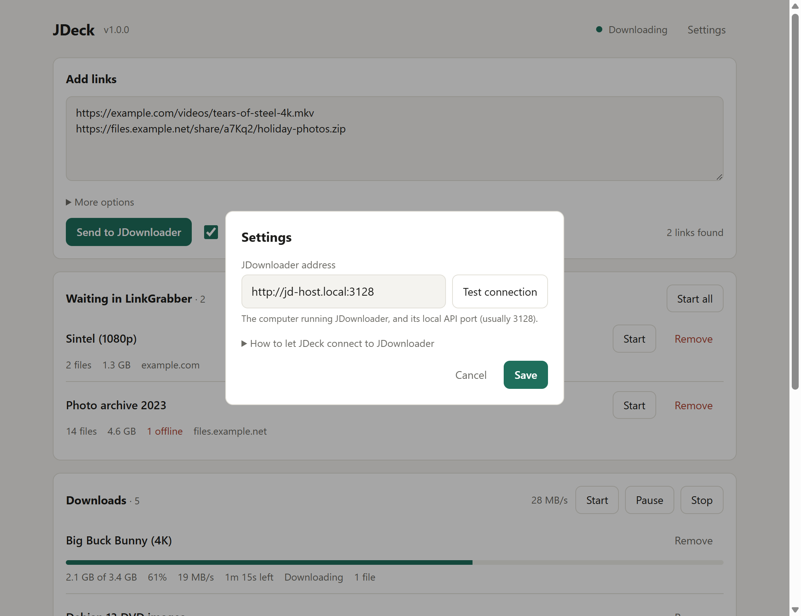

A modern front end for JDownloader 2. Send links and watch your downloads. JDeck comes in two editions:

- **JDeck Desktop**: a window on the computer you use. It connects to JDownloader on your network.
- **JDeck Server**: runs in the tray on the JDownloader computer. Phones, tablets and other computers use JDeck in a browser and sign in with a password.

JDeck talks to JDownloader through its local API. It does not use MyJDownloader or any cloud service. No account. No tracking. Everything stays on your network.

**Website:** [tariqmk.github.io/JDeck](https://tariqmk.github.io/JDeck/)

<picture>
  <source media="(prefers-color-scheme: dark)" srcset="assets/screenshots/downloads-dark.png">
  
</picture>

## Screenshots

<picture>
  <source media="(prefers-color-scheme: dark)" srcset="assets/screenshots/add-links-dark.png">
  
</picture>

<picture>
  <source media="(prefers-color-scheme: dark)" srcset="assets/screenshots/settings-dark.png">
  
</picture>

## Which Edition Do I Need?

| You want to | Use |
|---|---|
| Use JDeck in a window on one or more computers | **JDeck Desktop** on each computer |
| Use JDeck on phones, tablets or any browser at home | **JDeck Server** on the JDownloader computer |
| Keep JDownloader's API closed to the network | **JDeck Server** |
| Both | Both. They do not need each other. |

## Features

Both editions:

- Paste links, or any text that contains links. JDeck finds the links and removes duplicates.
- Start the downloads immediately, or hold them in the LinkGrabber.
- Set a package name and a save folder (optional).
- See the LinkGrabber. Start or remove each package.
- See the download list with progress, size, speed and time left. The list refreshes every 1.5 seconds.
- Start, pause and stop all downloads.
- Light and dark mode. Works at phone width.

JDeck Desktop:

- Its own window. Closing the window closes JDeck.
- **Test connection** and step-by-step help for the JDownloader settings.
- Nothing is open to the network.

JDeck Server:

- Sign-in page with a password. **Sign out** on each device.
- Tray icon with a control page: network address with a QR code for phones, password, port, start at login and **Quit**.
- Runs without a desktop with `--headless`.

## Download

Get the latest version from the [Releases page](../../releases/latest).

| Platform | JDeck Desktop | JDeck Server |
|---|---|---|
| Windows (x64) | `JDeck-Desktop-vX.Y.Z-windows-x64.exe` | `JDeck-Server-vX.Y.Z-windows-x64.exe` |
| macOS (Apple Silicon) | `JDeck-Desktop-vX.Y.Z-macos-arm64.zip` | `JDeck-Server-vX.Y.Z-macos-arm64.zip` |
| Linux (x64) | `JDeck-Desktop-vX.Y.Z-linux-x64.tar.gz` | `JDeck-Server-vX.Y.Z-linux-x64.tar.gz` |

**Note:** The builds are not code-signed.
- Windows: SmartScreen can show a warning. Select **More info**, then **Run anyway**.
- macOS: The first time you open the app, macOS blocks it. Open **System Settings > Privacy & Security** and select **Open Anyway**.

**Note:** JDeck Desktop uses the web engine that is part of the system.
- Windows: Microsoft Edge WebView2. It is part of Windows 10 and Windows 11.
- macOS: WebKit. It is part of macOS.
- Linux: WebKitGTK. Install it if it is not there, for example `sudo apt install gir1.2-webkit2-4.1` on Ubuntu. Without it, JDeck Desktop opens in your web browser instead.

**Note:** JDeck Server needs no web engine. Devices use their own browser.

## Set Up JDeck Desktop

### 1. Turn on the JDownloader local API

Do these steps on the computer that runs JDownloader 2.

1. In JDownloader, open **Settings > Advanced Settings**.
2. In the filter box, type `deprecated`.
3. Turn on **RemoteAPI: Deprecated Api Enabled**.
4. If JDeck Desktop runs on another computer, turn off **RemoteAPI: Deprecated Api Localhost Only**.
5. Make sure **RemoteAPI: Deprecated Api Port** is `3128`.
6. Restart JDownloader.

**Note:** The name "Deprecated API" is historical. It is JDownloader's local API.

**Caution:** The JDownloader local API has no password. After step 4, any device that can reach port 3128 can control JDownloader. Do this only on a trusted network. To keep the API closed, use JDeck Server instead.

### 2. Start JDeck Desktop

1. Put the JDeck file in a folder you can write to, for example `Documents\JDeck`.
2. Start JDeck. The first time, **Settings** opens.
3. In **JDownloader address**, type the JDownloader computer and port, for example `jd-host.local:3128`.
4. Select **Test connection**. The result is one of these:
   - **Connected to JDownloader.**
   - **JDownloader does not accept connections at this address.** The API is off, or open to its own computer only. Do step 1 again.
   - **Cannot reach JDownloader.** Check the address, and that the computer and JDownloader are on.
5. Select **Save**.

When JDownloader cannot be reached, the window shows the reason. Select **How to fix** to open the steps.

To use JDeck Desktop on another computer, copy it to that computer and do the same steps.

### Upgrading from JDeck v1.0.0

- JDeck Desktop copies the JDownloader address from the old `JDeck-data` folder the first time it starts. It does not change or delete that folder.
- Network sharing moved to JDeck Server. JDeck Desktop has no sharing settings.
- After JDeck Desktop works, you can delete the old `JDeck-data` folder.

## Set Up JDeck Server

### 1. Turn on the JDownloader local API

Do these steps on the computer that runs JDownloader 2. JDeck Server runs on the same computer.

1. In JDownloader, open **Settings > Advanced Settings**.
2. In the filter box, type `deprecated`.
3. Turn on **RemoteAPI: Deprecated Api Enabled**.
4. Keep **RemoteAPI: Deprecated Api Localhost Only** turned on.
5. Restart JDownloader.

**Note:** With step 4, the JDownloader API stays closed to the network. Other devices reach JDownloader only through JDeck Server and its password.

### 2. Start JDeck Server

1. Put the JDeck Server file in a folder you can write to.
2. Start JDeck Server. The JDeck icon shows in the tray (macOS: the menu bar). The first time, the control page opens in your browser.
3. Type a password two times. Select **Save and sign in**.
4. The control page shows the network address, for example `http://192.168.1.20:23128/`, and a QR code.

**Note:** If the browser does not open, select the tray icon, then **Open JDeck Server**.

**Note:** Windows asks to allow JDeck Server through the firewall the first time. Allow it on private networks. Other devices cannot connect without this.

### 3. Use JDeck on other devices

1. On the phone, tablet or computer, open the network address. On a phone, you can scan the QR code on the control page.
2. Type the JDeck Server password. Select **Sign in**.
3. Use JDeck. Select **Sign out** to end the session on that device.

**Note:** A session ends after 30 days without use, when the password changes, or when JDeck Server restarts.

**Note:** After 5 wrong passwords, that device must wait 30 seconds before it can try again.

### The tray icon

Select the tray icon to open the control page. The menu has these items:

| Item | What it does |
|---|---|
| **Open JDeck Server** | Opens the control page |
| **Open JDeck** | Opens the JDeck page on this computer |
| **Quit JDeck Server** | Stops JDeck Server |

**Note:** Ubuntu with GNOME shows tray icons only with the AppIndicator extension. Without it, use the control page or `--stop` to quit.

### The control page

The control page is `http://127.0.0.1:23128/server`. It opens only on the JDeck Server computer. On the JDeck page on that computer, select **Server settings** to open it.

| Item | What it does |
|---|---|
| **Status** | Shows the port, the number of signed-in devices and the JDownloader connection |
| **Phones and other devices** | Shows the network address with **Copy address** and a QR code |
| **JDownloader** | The JDownloader address. Default: `http://127.0.0.1:3128`. **Test connection** and **Save** |
| **Password** | Changes the password. All other devices must sign in again |
| **Port** | Changes the port. Default: `23128`. Open the new address on each device |
| **Start at login** | Starts JDeck Server when you log in to this computer |
| **Updates** | Shows the version. **Check for updates** |
| **Quit JDeck Server** | Stops JDeck Server |

### Quit JDeck Server

Use one of these:

- Tray icon > **Quit JDeck Server**.
- Control page > **Quit JDeck Server**.
- In a terminal: `JDeck-Server --stop`.

JDeck Server stops new connections, lets open requests finish (up to 3 seconds), saves its settings and exits.

### Run without a desktop (servers)

For a computer without a desktop, for example a home server:

1. Set the password in a terminal:
   ```bash
   ./JDeck-Server --set-password
   ```
2. Start JDeck Server without the tray icon:
   ```bash
   ./JDeck-Server --headless
   ```
3. To stop it, press **Ctrl+C**, or run `./JDeck-Server --stop` in another terminal.

**Note:** If a password is changed with `--set-password` while JDeck Server runs, restart JDeck Server to use it.

## Check for Updates

JDeck does not check for updates by itself.

- JDeck Desktop: select the version number next to **JDeck** at the top of the window.
- JDeck Server: on the control page, select **Check for updates**.

If a newer version is available, select **Open release page**. Download the new version and replace the old program. Keep the data folder next to it.

## Privacy

- No telemetry, analytics or tracking.
- No account and no cloud service. JDeck does not use MyJDownloader.
- JDeck Desktop makes these network connections only:
  - To the JDownloader address you set, to send links and read the download list.
  - To GitHub (api.github.com), only when you select the version number. It sends nothing else, and nothing is downloaded.
- The JDeck Desktop window talks to JDeck Desktop through `127.0.0.1` only. Other computers cannot reach it.
- JDeck Server makes these network connections only:
  - It serves the JDeck page on your network, on port `23128` by default.
  - To JDownloader on `127.0.0.1`.
  - To GitHub (api.github.com), only when you select **Check for updates**.
- Settings are stored in a folder next to the program: `JDeck-Desktop-data` or `JDeck-Server-data`. The password is stored as a salted hash, not as text.
- To move JDeck to another computer, copy the program and its data folder.
- **Start at login** writes one file outside the data folder, only while the option is on: a shortcut in the Windows Startup folder, a LaunchAgent in `~/Library/LaunchAgents/` on macOS, or a file in `~/.config/autostart/` on Linux.

**Note:** JDeck Server uses plain HTTP. A device on the same network can read the traffic. Use JDeck Server only on a trusted home network.

## Settings

### JDeck Desktop

| Setting | What it does |
|---|---|
| **JDownloader address** | The computer that runs JDownloader and its local API port. Example: `jd-host.local:3128`. |

### JDeck Server

The settings are on the control page. See [The control page](#the-control-page).

| Command-line option | What it does |
|---|---|
| `--headless` | Runs without the tray icon. |
| `--set-password` | Sets the password in the terminal, then exits. |
| `--stop` | Stops the JDeck Server that runs on this computer. |
| `--version` | Shows the version. |

## Run From Source

Requires Python 3.10 or later.

1. Create a virtual environment:
   ```bash
   python -m venv .venv
   ```
   On Windows, use `.venv/Scripts/python`. On macOS and Linux, use `.venv/bin/python`.
2. Install the packages for the edition you want:
   ```bash
   .venv/Scripts/python -m pip install -r requirements-desktop.txt
   ```
   ```bash
   .venv/Scripts/python -m pip install -r requirements-server.txt
   ```
   On Linux, JDeck Desktop also needs `pywebview[gtk]` and the WebKitGTK system packages.
3. Start an edition:
   ```bash
   .venv/Scripts/python jdeck_desktop.py
   ```
   ```bash
   .venv/Scripts/python jdeck_server.py
   ```

For how the code is organised, see [ARCHITECTURE.md](ARCHITECTURE.md).

### Run the tests

```bash
python -m unittest discover -s tests
```

## Update the Screenshots

The screenshots and brand images are made by scripts. They use made-up sample data and a fake JDownloader. They do not read or change your data folders.

1. Install the tools. They are only needed for these scripts:
   ```bash
   python -m pip install PySide6 Pillow
   ```
2. To retake the screenshots in `assets/screenshots/`, run:
   ```bash
   python assets/make_screenshots.py
   ```
3. To rebuild the icon files, the banner and the social card from `assets/icon/jdeck.svg`, run:
   ```bash
   python assets/make_assets.py
   ```
   This also refreshes the website's copies in `docs/` (`icon.svg`, `apple-touch-icon.png` and `social-card.png`).

## Website

The website is one page in `docs/`: `index.html`, `style.css` and `app.js`. It has no build step and loads nothing from other sites. The only outside request is to the GitHub API, to read the latest release.

### Preview the website

1. Start a local server:
   ```bash
   python -m http.server 8765 --bind 127.0.0.1 --directory docs
   ```
2. Open `http://127.0.0.1:8765/` in a browser.

**Note:** Opening `docs/index.html` as a file does not load the styles and scripts. Use the local server.

### Publish the website

Do these steps one time:

1. On GitHub, open **Settings > Pages**.
2. In **Source**, select **Deploy from a branch**.
3. Select the branch **main** and the folder **/docs**. Select **Save**.
4. On the repository page, select the gear next to **About**. Select **Use your GitHub Pages website**.

After that, each push to `main` updates the website.

The download section has a **Desktop | Server** switch above the 3 platform cards. The cards find their files on the latest release by name (`JDeck-Desktop-v…` and `JDeck-Server-v…`). A link to `#download-server` opens the page with **Server** selected.

**Note:** If the latest release has no Server files (v1.0.0), the switch is hidden and the Desktop cards use the old file names (`JDeck-v…`).

**Note:** The latest release does not include drafts or pre-releases. Until a public release exists, all download buttons open the Releases page.

## Creating a Release

Releases are built by GitHub Actions. The workflow builds JDeck Desktop and JDeck Server for Windows x64, macOS Apple Silicon and Linux x64, and attaches the 6 files to one GitHub release.

1. Push your changes to `main`.
2. On GitHub, open **Actions > Release**.
3. Select **Run workflow**.
4. Select the release type:
   - **draft**: creates a hidden release. Check it, then publish it on the Releases page.
   - **public**: publishes the release immediately.
5. Select the version bump: **patch** (1.2.3 to 1.2.4), **minor** (1.2.3 to 1.3.0) or **major** (1.2.3 to 2.0.0).
6. Select **Run workflow**.

The workflow:
- Runs the tests. If a test fails, nothing is built.
- Finds the highest existing `vX.Y.Z` tag or release (drafts included) and adds the bump.
- Writes that version into both editions. The source code keeps the development version `0.0.0.dev0`.
- Builds and checks 6 files. If one build fails, no release is made.
- Starts the release notes with a "Which download do I need?" section.
- Creates the tag on the built commit only after all 6 builds succeed.
- Never commits or pushes to any branch.

No secrets are needed.

## Disclaimer

JDeck is an independent project. It is not affiliated with or endorsed by AppWork GmbH or JDownloader.
